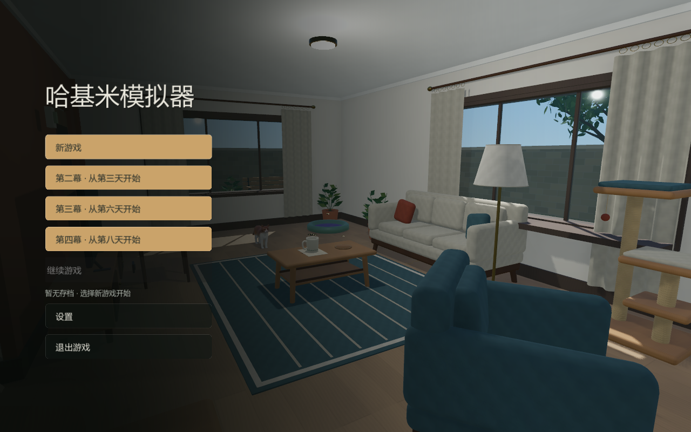
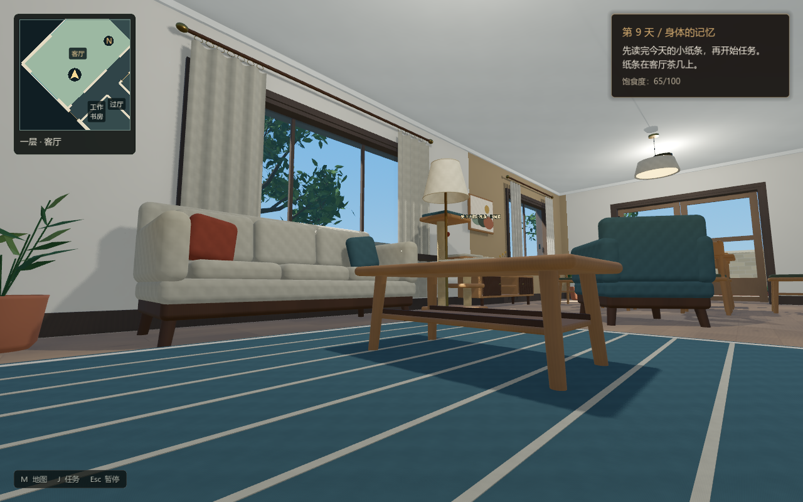
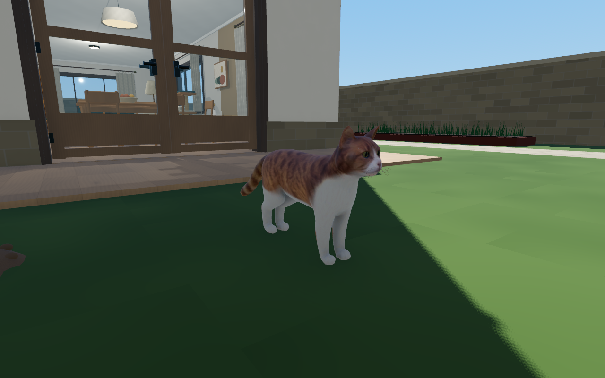
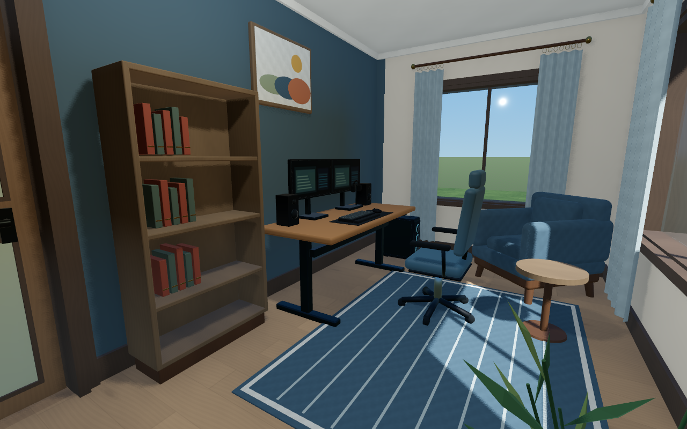
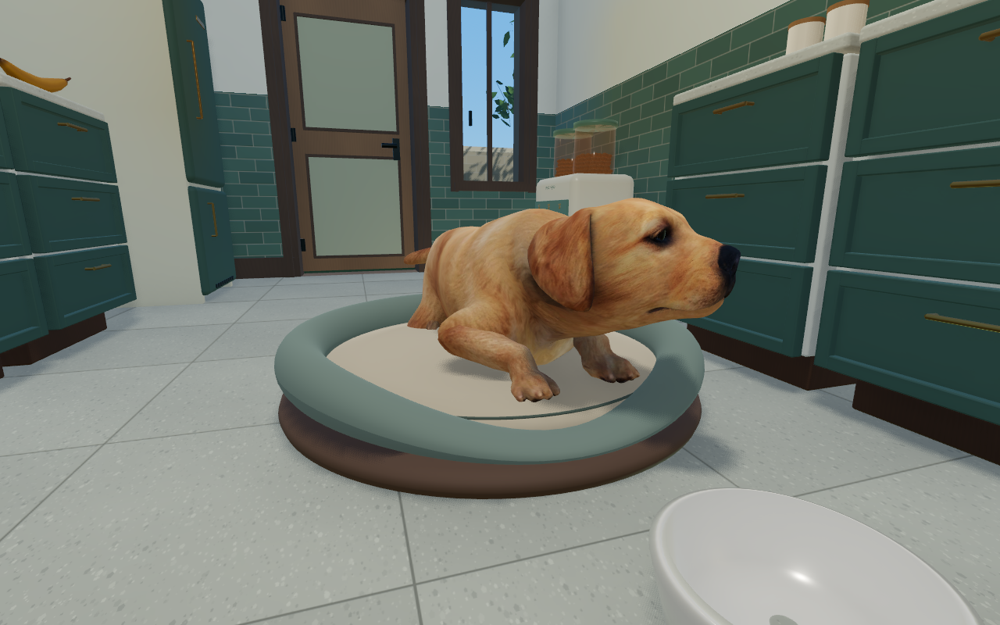
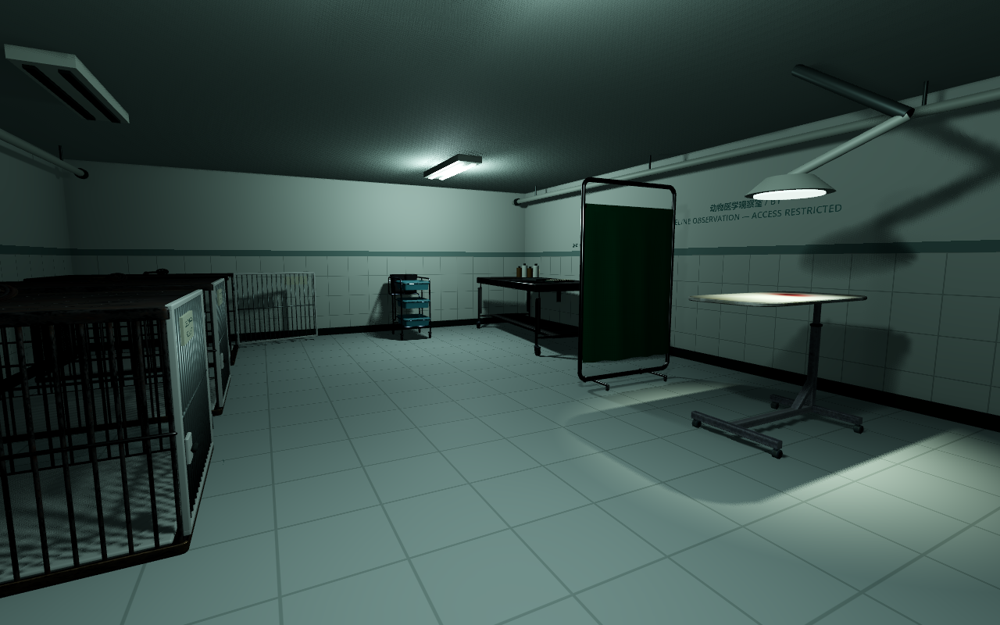
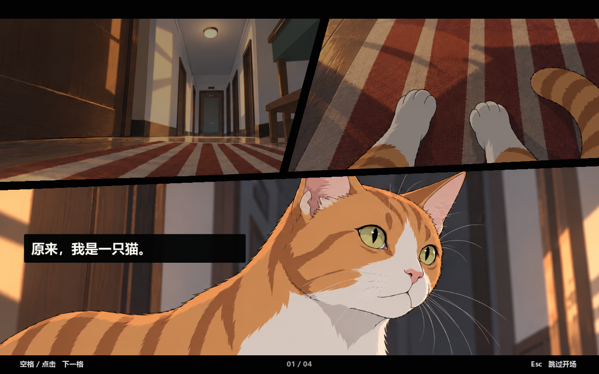

# 哈基米模拟器

**以猫的视角，探索一座有秘密的家。**

米酥在陌生的房子里醒来，想起了生病的主人。为了学会照顾她，它按照每日留下的纸条，整理房间、照顾大狗阿嚼，完成看似平常的家务。随着日期推进，照片、编号、监控和地下室逐渐串起另一段记忆。

这是使用 **Godot 4.7.1 / Forward+** 开发的第一人称 3D 猫咪探索解谜原型。当前已接入 **11 天主线、漫画开场、地下实验室及逃脱与归家结局**，并包含可选的搞怪彩蛋。关卡、美术与细节仍在持续迭代。

## 游戏体验

- **猫的尺度**：以低机位探索真实住宅比例的房间，跳上沙发、桌面、柜顶和猫爬架；移动、奔跑、低伏、喵叫和跳跃前爪均已接入。
- **完整的家**：两层独栋别墅、楼梯平台、室外花园、露台与地下医学实验室。房门可开关，笼舍可进入。
- **逐日推进的任务**：先读完当天的纸条，再开始任务；完成日程后回窝休息，进入下一天。
- **真实家具交互**：叼取与放下物品，使用洗衣机、水龙头、烤箱、书柜和电脑等现有家具完成任务。
- **不同类型的谜题**：颜色归位、管道连接、滑块机关、药瓶听音、声调、电路、重量感应、时钟、拼图与追捕。
- **同伴与线索**：喂食大狗、找回玩具、听它讲述过去，从日常物品中寻找主人的痕迹。
- **连续的视听与界面**：约 55 秒的分格漫画开场、随室内外平滑变化的夏日环境声、自动切换区域的小地图、任务日志与饱食度显示。

## 实机画面

以下图片由当前工程直接渲染；场景展示使用不写入正常存档的预览会话。

| 猫眼高度的客厅 | 当前猫模型与花园 |
| --- | --- |
|  |  |

| 二楼电脑房 | 大狗阿嚼 |
| --- | --- |
|  |  |

| 地下医学实验室 | 漫画开场 |
| --- | --- |
|  |  |

## 运行游戏

1. 安装 **Godot 4.7.1 标准版**，下载完整仓库。
2. 在 Godot 项目管理器中导入根目录的 [`project.godot`](project.godot)，等待首次资源导入完成。
3. 按 **F5**，在主菜单选择「新游戏」或「继续游戏」。

Windows 下也可双击 [`开始游戏.cmd`](开始游戏.cmd) 或 [`打开编辑器.cmd`](打开编辑器.cmd)。启动器会查找已配置的本机 Godot 路径；其他电脑可直接通过 Godot 导入项目。

当前开发期菜单也提供从第三、第六、第八天开始的章节入口，便于快速查看后续内容。

正常游玩不需要 Blender、Python、FFmpeg 或原始素材所在的 `C:\zGoDot\3D` 文件夹。模型、贴图、已转换的音视频及关卡资源均在工程中。当前验证环境为 Windows / Vulkan / Forward+，其他引擎版本和平台未作完整验证。

## 操作

| 按键 | 用途 |
| --- | --- |
| WASD / 鼠标 | 移动 / 环顾 |
| 空格 / Shift / Ctrl | 跳跃 / 奔跑 / 低伏 |
| E | 交互、阅读、叼取或按提示放置物品 |
| G | 按当前任务规则放下手持物 |
| R | 部分任务中切换尺子方向，或重听指定旋律 |
| Q / V | 喵叫 / 查看猫咪，再按 V 返回第一人称 |
| M | 打开或关闭区域地图 |
| J | 打开或关闭任务日志 |
| Esc | 关闭当前面板、跳过支持的过场，或暂停 |

看向可交互物品时，屏幕下方会出现对应提示。小游戏以各自面板中的说明为准。漫画会自动推进，也可按空格、Enter、E 或点击画面翻到下一格；Esc 跳过整个开场。

## 场景与流程

一楼包含客厅、餐厅、厨房、工作书房、卫生间和洗衣间；二楼包含主卧、次卧 A、电脑房、书房、阅读角、卫生间、衣帽间和露台。花园围绕住宅展开，地下室通过楼梯和剧情密码门进入。

当前流程从第 1 天推进到第 11 天。下面列出完整章节内容，不包含具体密码和谜题答案。

展开章节概览（含后期剧情提示）

| 日期 | 章节 | 主要内容 |
| --- | --- | --- |
| 第一天 | 陌生的家 | 学会移动与攀跳，整理茶几，收集一楼纸片，关灯并准备两份晚饭 |
| 第二天 | 学着照顾 | 收集待洗衣服，使用洗衣机；借助尺子取回毛线球，冲洗并送回狗盘 |
| 第三天 | 被观察的日常 | 按颜色整理书柜，发现照片，修水管、浇花并照顾大狗 |
| 第四天 | 只剩一条鱼 | 研究冰箱机关，烤鱼、分享食物；寻找大狗的玩具 |
| 第五天 | 记得你的名字 | 摇晃七瓶密封药辨别药量，想办法喂药，从声调和编号中找回名字 |
| 第六天 | 楼梯之上 | 给阿嚼带饭，进入二楼，在各房间寻找小鱼干 |
| 第七天 | 我的名字 | 处理停电，研究电路、座椅感应和电脑里的线索 |
| 第八天 | 倒走的时间 | 取到柜顶猫粮，调整被水垢遮住的温度旋钮，寻找时、分、秒三张纸条 |
| 第九天 | 身体的记忆 | 调整露台植物顺序，去花园扑地鼠，在书房完成拼图 |
| 第十天 | 主人的命令 | 追捕老鼠，发现它带来的纸条 |
| 第十一天 | 来地下室 | 解开入口装置，调查实验室与笼舍，寻找逃离路线并进入结局 |

可选彩蛋与独立预览

- 大狗转移到厨房后，部分对话有机会引出特殊演出。
- 二楼次卧 A 的桌底藏着红色按钮；第一次提示，确认后才开始。
- 客厅电视下方的电源开关可播放短视频，约 5 秒后自动关机。
- 厨房冰箱旁台面的香蕉可以互动，短片结束后恢复。
- 根目录的「预览漫画开场」「预览大狗彩蛋」「预览次卧彩蛋」「预览地下室」启动器用于单独查看对应内容；这些预览关闭正常存档写入。

狗的演出包含短暂闪白，可按 Esc 退出。彩蛋不会替代当天的必做任务。

## 存档

主菜单可新开游戏或继续已有进度，暂停菜单提供保存入口。开始新游戏前会确认并备份原进度。继续存档不强制重播漫画开场。

Windows 默认存档位置为 `%APPDATA%\Calico_DayOne\day_one_v1.json`。存档位于项目外，更新或整理工程文件不会主动重置它。测试与独立预览应使用禁用保存或单独存档路径的模式。

## 工程结构与协作

| 路径 | 内容 |
| --- | --- |
| `scenes/`、`scripts/`、`shaders/` | 主场景、住宅、玩家控制、交互、过场与渲染 |
| `day1/`、`day2/` | 前两天任务、共享角色状态、纸条与日常交互 |
| `act2/`、`act3/`、`act4/`、`ending/` | 第 3–11 天及结局 |
| `quest_system/`、`villa_maps/` | 任务管理、存档、日志与地图 |
| `assets/` | 角色、正式漫画、音视频等游戏资源 |
| `furniture_pack/` | 家具、任务道具、地下室资产、材质及建模源文件 |
| `tools/` | 可复用的生成、截图与验证工具 |
| `docs/`、`previews/showcase/` | 当前开发说明、分镜与本 README 的实机图片 |

地图调整可能同时涉及场景、脚本、模型、材质和任务资源，协作时应提交本次修改的完整依赖。`.godot/` 是各电脑生成的本地缓存，不上传；`.uid` 和资源旁的 `.import` 保存资源标识、导入设置，需要一起保留。

开发入口、资源维护方式、验证命令和已知检查限制见 [开发与目录说明](docs/DEVELOPMENT.md)。漫画内容见 [开场分镜](docs/OPENING_STORYBOARD.md)，本次整理范围见 [清理记录](docs/CLEANUP.md)。

## 项目小组

东西绿豆：马肖杰、倪梓凯、张宇博。
