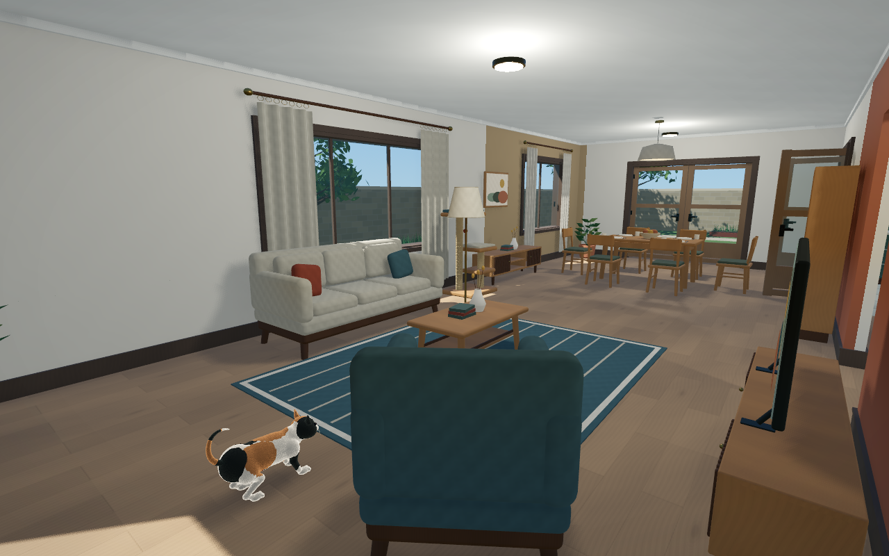
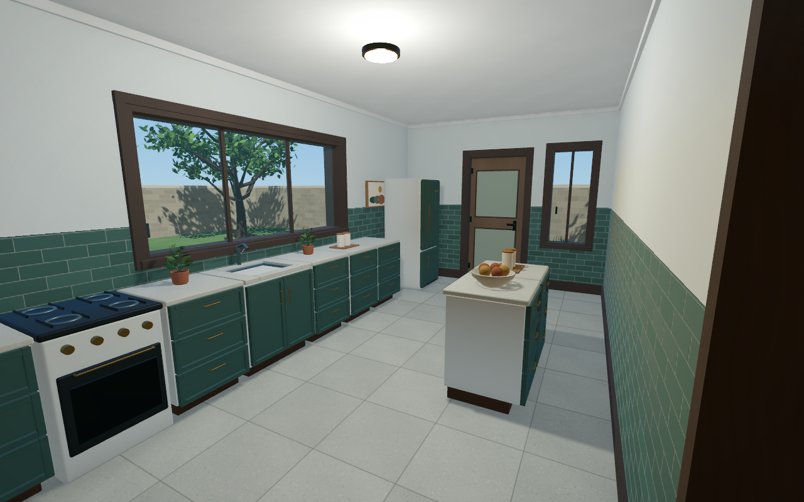
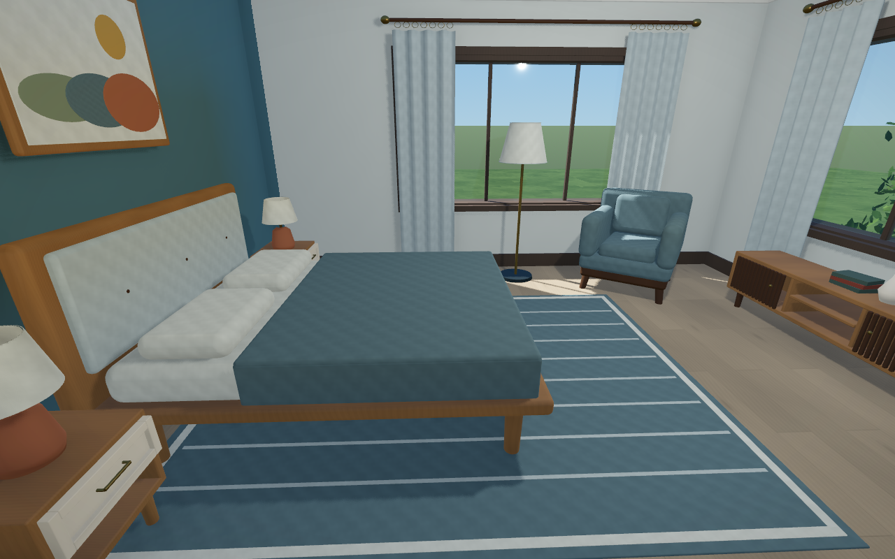
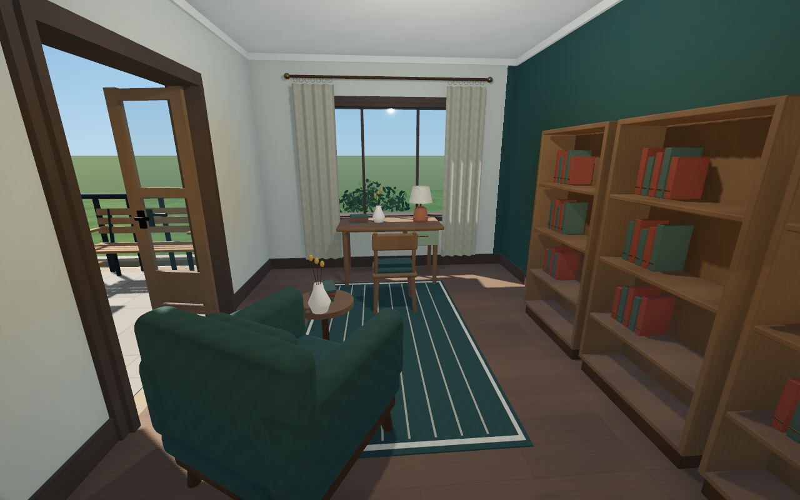

# 花园别墅 · 家具与生活陈设布置

现有 20 种家具与 24 种生活资产，共 44 种独立场景，已在房屋、露台和花园中摆放 163 个家具陈设实例，走廊另有 10 块可编辑门牌。各家具保持真实住宅尺寸，猫保持现有 0.8 倍模型与 22.4 厘米眼高。

已增加木材、织物、灰泥和石材细节，以及按房间区分的墙地面和软装配色；厨房、书房、洗衣间、衣帽间和露台的 9 扇门扇默认敞开。详见 [材质与房间风格](材质与房间风格.md)。

## 各区域布置

| 区域 | 布置 |
|---|---|
| 一层客厅 | 窗边三人沙发、扶手椅、茶几、电视柜与电视、地毯、书架、猫爬架、猫食水碗、窗帘、绿植与落地灯 |
| 餐厅 | 六把餐椅、餐桌、四套餐具、中央果盘、亚麻吊灯、低边柜和挂画 |
| 厨房 | 北侧连续橱柜、水槽、灶台烤箱、冰箱，中央双柜备餐台，香草盆栽、砧板和储物罐 |
| 入户过厅 | 窄型玄关桌、长毯、花瓶书册、挂画与盆栽，保留进门通道 |
| 客卧、二层次卧 B | 双人床、两侧床头柜和台灯、侧边衣柜、休闲椅、窗帘、地毯与绿植 |
| 主卧 | 双人床、双床头柜与台灯、衣柜、窗下低柜、休闲椅、地毯与落地灯 |
| 次卧 A | 双人床、衣柜、床头柜、学习桌椅、书架、台灯、窗帘与植物 |
| 书房 | 窗边书桌椅、三组书架、阅读扶手椅、圆边几、落地灯、挂画、花瓶书册与地毯 |
| 阅读角 | 扶手椅、书架、边几、落地灯、植物与窗帘 |
| 两层卫生间 | 台上盆浴室柜、坐便器、玻璃淋浴角、浴垫、毛巾壁架与小盆栽 |
| 洗衣间 | 滚筒洗衣机、洗衣篮、毛巾与壁架 |
| 衣帽储物 | 适配窄房间的开放挂衣架、衣物、毛巾和收纳篮 |
| 露台 | 两张木条长椅、茶几、果盘与植物，留出两处露台门的通路 |
| 花园 | 北侧木平台休息区，以及入户庭院的长椅与绿植 |

厨房窗台抬高到 1.08 米，与 0.90 米台面衔接；上层对应窗户保持原样。吸顶灯外壳不再投射遮住自身光源的大圆形阴影，家具仍保留正常受光与阴影。

## 后续调整

在 Godot 中打开 `scenes/villa.tscn`，展开 `GroundFloor/Furnishings` 或 `UpperFloor/Furnishings`。家具按 Living、Dining、Kitchen、MasterBedroom 等房间分组；花园摆件在 `Garden/Furnishings/Garden`。每件都是 `furniture_pack/scenes/` 中资产的实例，可直接移动和旋转，也可继续复用。

`scripts/villa_furnishings.gd` 保存可重复生成的布局，坐标以房屋西北角为 (0,0)，单位为米。根节点底面贴地；少量地毯和窗帘按空间调整平面尺寸，正常家具保持原比例。`furniture_pack/villa_layout.json` 提供每个实例的完整清单。

若直接在编辑器中调整 `villa.tscn`，之后运行房屋生成工具会重建场景；希望长期保留的布局应同时修改 `villa_furnishings.gd`。原始家具和新增陈设由不同生成器维护，分别为 `build_pack.gd` 与 `build_decor.gd`。

## 验证

- 19 扇门，以 399 个角度采样检查开启范围，未与家具碰撞。
- 检查所有已摆放实体家具，未发现不同家具实例之间的实体碰撞重叠。
- 使用与游戏一致的猫站立胶囊体（高 0.288 米、半径 0.096 米）检查楼层通路，14 个室内区域全部可到达。
- 原游戏测试通过：19 扇门交互、16 处实际门洞通行、楼梯完整上下行、蹲伏、跳跃、楼层总览与暂停恢复。

家具、抽屉、电器目前为静态资产；房门继续保留 E 键开关功能。

## 实际效果

更多图片在 `previews/furnished_villa/`，包括两层展开图、猫眼高度、客卧、卫生间、露台和花园。
